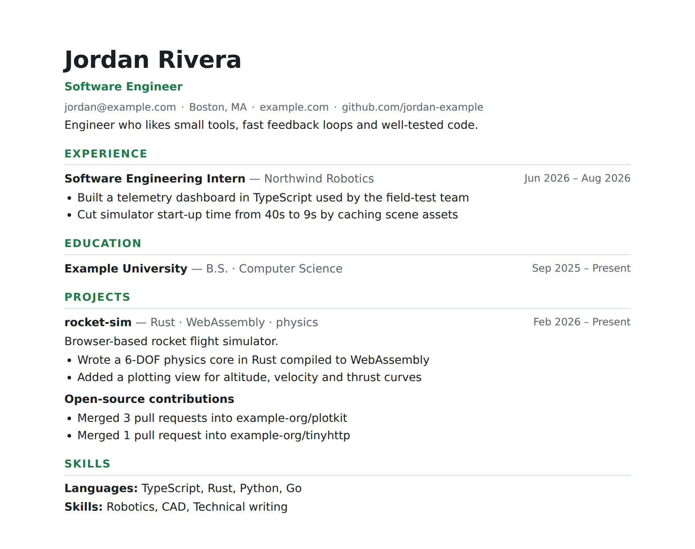

<div align="center">

# Evergreen

**Ship code, update LinkedIn, and get a pull request with your refreshed resume every Monday.**

[](https://github.com/flushloll/evergreen/actions/workflows/test.yml)
[](pyproject.toml)
[](https://jsonresume.org/schema)
[](action.yml)
[](LICENSE)

[Quick start](#quick-start) · [How it works](#how-it-works) · [What gets synced](#what-gets-synced) · [AI bullets](#ai-bullets-optional) · [FAQ](#faq)

<code>pip install git+https://github.com/flushloll/evergreen</code>

<br /><br />



</div>

---

Your resume goes stale the moment you push a new project. Evergreen keeps one `resume.yaml` ([JSON Resume](https://jsonresume.org) format) as the source of truth. On a schedule, it pulls your newest GitHub work and your LinkedIn history into that file, renders it to **Markdown, HTML and PDF**, and opens a **pull request** for you to review. It never silently rewrites what you wrote.

## Quick start

**1. Scaffold a resume repo** (a new, ideally private repo works best):

```bash
pip install git+https://github.com/flushloll/evergreen
evergreen init --github <your-username>
```

This creates `evergreen.yml` (settings), `resume.yaml` (your resume) and `.github/workflows/evergreen.yml` (a weekly job).

**2. Sync and render locally:**

```bash
evergreen sync      # pull GitHub (+ LinkedIn) into resume.yaml
evergreen render    # → dist/resume.md, resume.html, resume.pdf
```

Edit `resume.yaml` however you like. Your words always win.

**3. Push it to GitHub.** Turn on **Settings → Actions → General → Allow GitHub Actions to create pull requests**. You'll get a `🌲 Resume refresh` PR whenever something new shows up. Run it on demand from the **Actions** tab.

> [!TIP]
> **Adding LinkedIn.** LinkedIn has no public profile API, so Evergreen reads the export LinkedIn gives you instead of scraping.
> Request it under **Settings → Data privacy → Get a copy of your data**, then:
> ```bash
> evergreen import-linkedin ~/Downloads/Basic_LinkedInDataExport.zip
> ```
> Only the five resume CSVs are copied. Messages and connections never touch your repo. Re-import when you update LinkedIn.

## How it works

```text
GitHub API ──┐
             ├──> evergreen sync ──> resume.yaml ──> evergreen render ──> md · html · pdf
LinkedIn  ───┘    (fill, never        (yours)
export             overwrite)

Every Monday the GitHub Action runs both steps and opens a PR you review and merge.
```

The merge follows three rules:

- **Fill, don't overwrite.** A field is only set if it's empty. Keyword lists are unioned.
- **Deletes stick.** Remove a project you don't want and it won't come back.
- **Everything is a diff.** Locally, run `evergreen sync --dry-run` to preview. In CI, it's a PR.

## What gets synced

| Source | Resume section | Details |
| --- | --- | --- |
| GitHub profile | `basics` | Name, website, location, bio, GitHub link |
| Your repos | `projects` | Top `max_projects` non-fork repos with a description, ranked by `recent` or `stars`. Languages and topics become keywords. Inactive repos get an end date |
| Merged PRs to others' repos | `projects` → *Open-source contributions* | "Merged 3 pull requests into org/repo" |
| Repo languages | `skills` → *Languages* | Ordered by bytes of code |
| LinkedIn `Positions.csv` | `work` | Company, title, dates, description |
| LinkedIn `Education.csv` | `education` | School, degree, dates |
| LinkedIn `Skills.csv`, `Certifications.csv` | `skills`, `certificates` | |

All knobs live in `evergreen.yml`: `exclude`, `min_stars`, `rank`, `max_projects`, render `formats` and more.

## AI bullets (optional)

New projects arrive with a description but no bullet points. Set `ai.enabled: true` and add an `ANTHROPIC_API_KEY` repo secret, and Claude drafts up to 3 highlights per *new* project from its README. The prompt forbids invented metrics, and existing bullets are never touched. Drafts show up in the PR, marked for review.

```bash
pip install "evergreen-cv[ai] @ git+https://github.com/flushloll/evergreen"
ANTHROPIC_API_KEY=sk-... evergreen sync --ai
```

## FAQ

**Will it overwrite my edits?** No. It only fills empty fields, adds keywords, and adds entries it hasn't added before. The one exception is the *Open-source contributions* entry, which it fully manages.

**Can I use my own theme?** Yes. `resume.yaml` is standard JSON Resume, so any [JSON Resume theme](https://jsonresume.org/themes) works. The built-in HTML/PDF is a clean one-page-friendly default.

**Where does the PDF come from?** Headless Chrome/Chromium prints the HTML. It's preinstalled on GitHub's runners. Locally, Evergreen uses Chrome if it finds it and skips the PDF otherwise.

**Does it need a token?** No for public data. In Actions, the built-in `GITHUB_TOKEN` is used automatically.

## License

[MIT](LICENSE)
